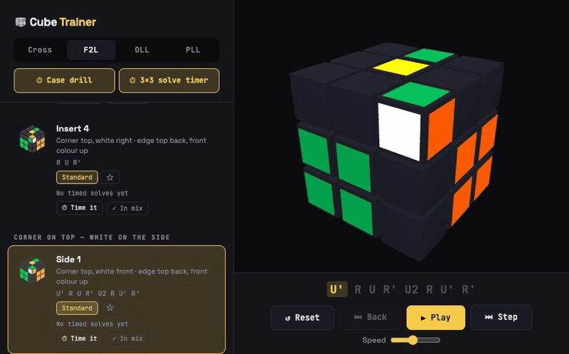
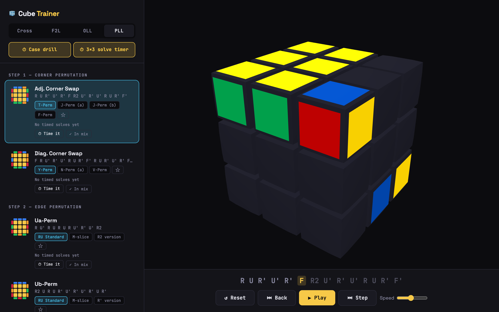
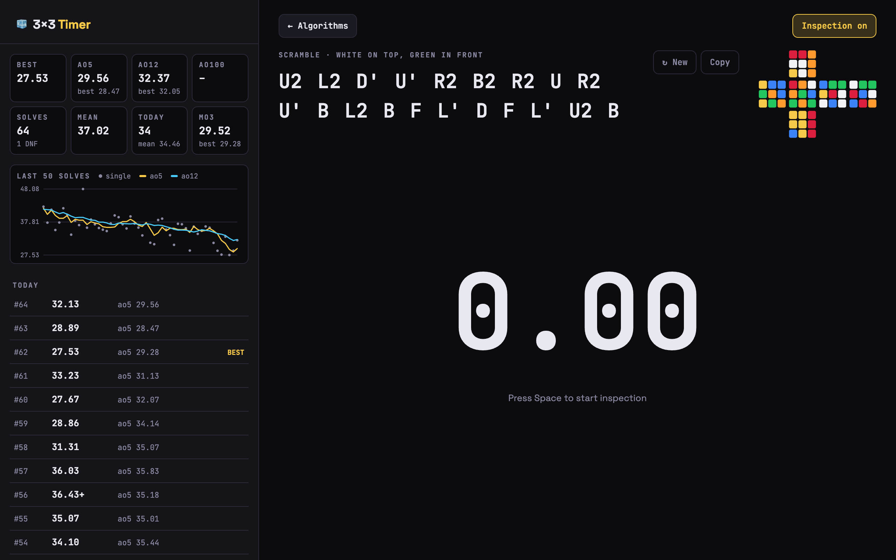
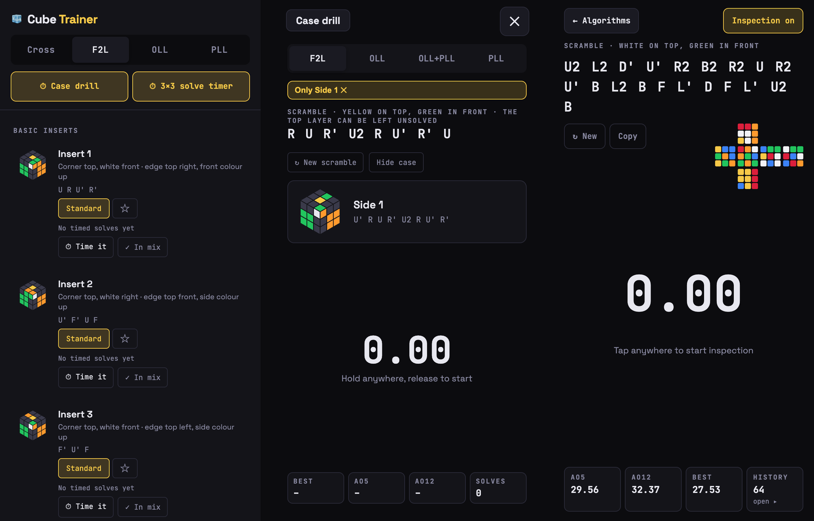

# Cube Trainer

Learn to solve a 3×3 faster: every step of CFOP on an interactive 3D cube, a drill that
times single cases, and a full-solve timer with competition-style scrambles.

**Live: [cube.lyuz.net](https://cube.lyuz.net)** · works on phones, installable as an app



## What it does

**Learn** — pick a case, pick an algorithm, step through it or play it on the 3D cube.
Only the pieces the step is about are coloured.

| Step | Cases |
| --- | --- |
| Cross | the 11 ways one edge can sit, with the shortest way home (the cross is planned, not memorised) |
| F2L | all 41 cases for the front-right slot, without cube rotations |
| OLL | two-look: 3 edge cases, then 7 corner cases |
| PLL | two-look: 2 corner cases, then 4 edge cases |

**Drill** — a scramble for your real cube sets up one F2L, OLL or PLL case, then you time
it. Stats are kept per case, and the cases you are slowest at come up more often.

**Time full solves** at [`/timer`](https://cube.lyuz.net/timer):

- random-state scrambles: a uniformly random cube position solved by a two-phase search,
  the way official scrambles are made (21 moves or fewer in practice)
- hold-and-release start, optional 15-second inspection with +2 and DNF
- ao5, ao12, ao100, mo3, a progress chart, and a history that keeps every scramble
- JSON export and import

Everything is stored in your browser. There are no accounts and no analytics; fonts and
three.js are loaded from public CDNs.

## Screenshots







## Run it

No build step: `public/` is served as it is.

```sh
npm install        # once: installs wrangler
npm run dev        # http://localhost:8787
npm test           # cube model, scrambler, timing rules, every algorithm
```

`npm run deploy` runs the tests and publishes `public/` to the Cloudflare Worker named in
`wrangler.jsonc`. That is the author's Worker and domain: to host your own copy, change
`name` and `routes` there first, then `npx wrangler login`.

## How it is put together

| File | What it is |
| --- | --- |
| `public/index.html` | the algorithm pages, 3D cube (three.js) and case drill |
| `public/timer.html` | the full-solve timer |
| `public/js/algs.js` | every case and algorithm |
| `public/js/cube.js` | sticker-level cube model that applies any move notation |
| `public/js/scrambler.js` | random cube state and two-phase solver, run in `scramble-worker.js` |
| `public/js/timer-core.js` | WCA timing rules: truncation, penalties, averages |
| `test/` | `node --test` suites, not deployed |

The tests are what keep the content honest. Every algorithm is replayed on the cube model
to check that it leaves the rest of the cube alone, that all variants of a case solve the
same case, and that each step's list is complete (41 distinct F2L cases, 11 cross cases).
Every generated scramble is applied to a solved cube and compared with the position it was
meant to produce. `SCRAMBLES=1500 npm test` checks more of them.

## Credits

- [three.js](https://threejs.org) (MIT) draws the cube
- the scrambler is an independent implementation of Herbert Kociemba's
  [two-phase algorithm](https://kociemba.org/cube.htm)
- the algorithms are the ones the speedcubing community has shared for years
- fonts: Space Grotesk and JetBrains Mono (SIL Open Font License)

## Licence

[MIT](LICENSE)
